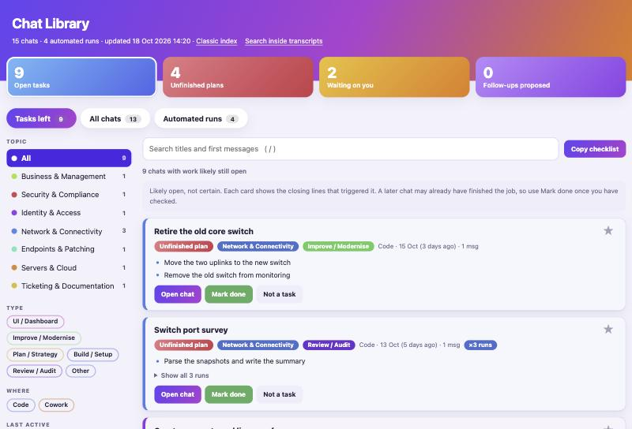

# Chat Library

**Find the work you left unfinished in your Claude chats.**



*The screenshot uses invented sample chats.*

If you use Claude Code or Cowork a lot, your history fills up with hundreds of chats. Many end with a question you never answered or a step you meant to do later, and they are buried under automatic scheduled runs.

Chat Library reads those chats on your own Mac and gives you one colourful page:

- **Tasks left:** chats that look unfinished, each with the closing lines that triggered the flag.
- **Topics and types:** every chat sorted by subject (network, identity, servers, and so on) and by kind of work (fix, build, plan, review).
- **Automated runs:** scheduled tasks moved out of the way. Repeat chats with the same title fold into one card.
- **Pin, mark done, copy checklist:** pin what matters, tick off what is finished, and copy the open list as a markdown to-do list.

It sits on top of [claude-code-log](https://github.com/daaain/claude-code-log) (MIT), which renders the transcripts. This project adds the library page, the sorting, the open-task detection and the setup scripts. Everything runs locally and nothing is uploaded.

## Try it in one minute

You need a Mac and [uv](https://docs.astral.sh/uv/) (`brew install uv`). The demo uses invented chats, so you can look around without your own history.

```bash
git clone https://github.com/Anirudhhat61/claude-chat-library.git
cd claude-chat-library
bash scripts/demo.sh
```

It opens the page at `http://127.0.0.1:8011/library.html`. Stop it with `pkill -f chat-library-demo`.

## Use it on your own chats

```bash
bash scripts/install.sh
```

This installs the viewer, builds your library, and registers two per-user background jobs. One starts the page at login. The other refreshes it every Monday at 7:00. Read `scripts/install.sh` first if you want to see exactly what it sets up.

Your page is then at `http://127.0.0.1:8010/library.html`. To skip the background jobs, install the viewer yourself with `uv tool install claude-code-log==1.7.0` and run `bash scripts/refresh.sh --open` whenever you want a fresh view.

To remove everything: `bash scripts/uninstall.sh`. Your archive is not deleted.

## How "Tasks left" works

It uses plain rules, so it is fast, free and only a best guess. A chat is flagged when:

| Label | Why it is flagged |
|---|---|
| **Unfinished plan** | Its last to-do list still has pending items. |
| **Waiting on you** | The last assistant message asks you something. |
| **Open items noted** | The last message says things like "next steps", "still need", "blocked" or "waiting on". Phrases like "nothing left to do" are ignored. |
| **Follow-up proposed** | A follow-up session was suggested but never started. |

Every card shows the lines that triggered it so you can judge. **Mark done** and **Not a task** are remembered in your browser only.

## Customise

On first run a `categories.json` appears in your archive folder. Rules run top to bottom and the first regex match wins. Each topic has a hue for its colour. Pin one chat with `overrides`. Then run `bash scripts/refresh.sh`.

## Privacy and safety

- The viewer listens on `127.0.0.1` only and runs inside a macOS sandbox that blocks all outbound network except loopback.
- Your originals are only read. The page works on a separate copy.
- Chat text is shown with `textContent`, never `innerHTML`, so a chat containing HTML cannot run script in the page.
- **The copy contains everything you typed, including anything pasted such as passwords.** Never commit it, email it or put it in a synced folder. The `.gitignore` blocks the archive, logs and your rules file.
- The viewer is pinned to version 1.7.0. Before upgrading, check its security advisories.

## Requirements and limits

- macOS only. The scripts use `rsync`, `sandbox-exec` and `launchd`.
- Reads Claude Code chats from `~/.claude/projects` and Cowork chats from the Claude desktop app's folder.
- The flags are a best guess. A later chat may already have finished the job.
- For people with no IT background, see [docs/Manager-Guide.md](docs/Manager-Guide.md).

## Where things live

| What | Where |
|---|---|
| Code | this repository |
| Archive, catalog, logs and your rules | `~/Documents/Claude-Chat-Viewer` (override with `CHAT_LIBRARY_HOME`) |
| Port | 8010 (override with `CHAT_LIBRARY_PORT`) |

## Licence

[MIT](LICENSE).
